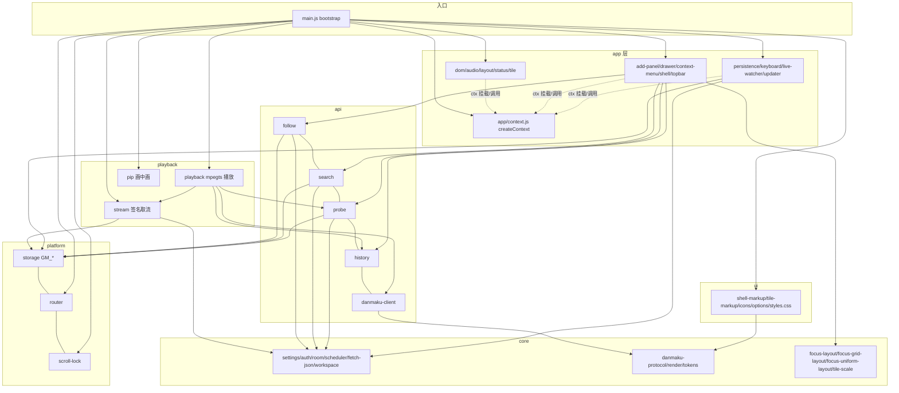

# 监控室(douyu-monitor)Code Wiki

> 基于源码工程 `d:\PROJECT\mom\douyu-monitor` 当前状态(脚本版本 v1.4.5)生成的结构化代码百科。
> 内容覆盖:整体架构、模块职责、关键类与函数、依赖关系、运行与发布方式、测试体系与开发约定。

---

## 目录

1. [项目概览](#1-项目概览)
2. [整体架构](#2-整体架构)
3. [目录结构](#3-目录结构)
4. [模块详解与关键类/函数](#4-模块详解与关键类函数)
5. [关键运行流程](#5-关键运行流程)
6. [依赖关系](#6-依赖关系)
7. [运行方式(开发/构建/发布)](#7-运行方式开发构建发布)
8. [测试体系](#8-测试体系)
9. [开发约定与注意事项](#9-开发约定与注意事项)

---

## 1. 项目概览

**监控室**是一个运行在斗鱼直播网页(`https://www.douyu.com/*`)上的 Tampermonkey 油猴脚本,核心能力是"我的关注"页多路直播同屏监看:

- **多路播放**:最多 16 个画格(tile)同时拉流播放(FLV over MSE,基于 mpegts.js),带并发调度、限流冷却与自动重连。
- **三层 UI**:全局入口条 + 模态监控室(dialog + Shadow DOM)内的画格墙 + 右侧设置抽屉。
- **布局系统**:自动平铺 / 1-4 列固定布局 / 焦点放大模式(主窗 + 右侧与底部小窗带,满屏装配算法)。
- **弹幕**:每路独立 WebSocket 弹幕连接,飘屏(DOM/canvas)与右侧悬浮栏双模式,贵族/粉丝牌/等级徽章令牌渲染。
- **音频模型**:主增益 × 每路音量,mix/solo/mute 三模式,独奏跟随焦点。
- **开播提醒**:轮询空闲房间状态,开播时 Toast/系统通知/提示音/自动取流。
- **工作区持久化**:布局、房间列表、偏好经 GM 存储保存,支持预设、历史房号、恢复询问语义。
- **自更新检测**:经 jsDelivr 多镜像比对远端版本,顶栏徽标提示升级。

工程形态:日常开发在 `src/` 的 ES Module 模块中进行,`npm run build` 用 esbuild 组装为**单文件 IIFE** 产物 `dist/douyu-monitor.user.js`,拖入 Tampermonkey 即装。同时产出 iPad Safari Stay 插件专属版 `dist/douyu-monitor.stay.user.js`(双轨构建)。

| 项 | 值 |
|---|---|
| 包名 / 版本 | `douyu-monitor` / `1.4.5`(以 `package.json` 为单一事实源) |
| 运行时依赖 | `mpegts.js@1.7.3` |
| 开发依赖 | `esbuild@0.24.2`、`happy-dom@16.8.1` |
| 模块体系 | ESM(`"type": "module"`),Node ≥ 18(使用 `node --test`) |
| 分发仓库 | 源码 `undotot/dy-monitor`,产物 `undotot/monitor-js`(jsDelivr CDN) |

---

## 2. 整体架构

### 2.1 运行时形态

脚本注入斗鱼页面后:

1. 仅在顶层窗口、同源 `www.douyu.com`、且位于"我的关注"路由(`/directory/myFollow`)时激活;SPA 路由切换由 `platform/router.js` 监听后重新 bootstrap。
2. 在 `document.body` 挂载宿主 `<div id="douyu-monitor-userscript">`,通过 **Shadow DOM** 隔离样式;全部 UI(入口按钮、`<dialog>` 面板、画格墙、抽屉、右键菜单、Toast)都在 Shadow 内。
3. 面板打开用 `dialog.showModal()` + 页面滚动锁 + 暂停官方播放器;关闭时逆操作。
4. 初始化整体包在 try/catch 中,异常只打 console,绝不影响主站浏览。

### 2.2 分层架构

依赖方向严格单向(禁止逆向 import,如 ui ↔ playback 不得互引):

```
core(纯函数,零依赖)
  ↓
platform(GM_* 适配,GM_* 只允许出现在这一层)
  ↓
api(斗鱼/第三方接口)   ui(DOM 模板/样式,只碰 DOM)
  ↓
playback(取流签名、mpegts 播放、画中画)
  ↓
app(initXxx(ctx) 装配模块,业务编排)
  ↓
main.js(bootstrap 入口)
features/groups(独立扩展,由 app/add-panel.js 单行挂载,可随时拆卸)
```



### 2.3 ctx 模式(核心设计模式)

`src/app/context.js` 的 `createContext()` 返回**唯一共享状态对象**。所有 app 模块以 `initXxx(ctx)` 形式初始化,把自己的函数挂到 `ctx` 上;跨模块调用只经 `ctx.xxx`,模块内部直呼本模块函数,禁止隐式闭包耦合。

ctx 上的关键状态:

| 字段 | 说明 |
|---|---|
| `host/wrapper/dialog/wall/appShell/els/emptyEl/pageScrollLock` | DOM 引用(main.js 注入;`els` 为 query 收集的关键控件) |
| `tiles: Map<id, tile>` | 画格注册表,插入顺序即墙顺序(换位靠重建 Map) |
| `scheduler: Scheduler(8)` | 并发额度调度器 |
| `logs: string[]` | 诊断日志(上限 150 条) |
| `pendingTiles` | 上次保存但**尚未装配进墙**的房间(“暂不加载”语义的载体) |
| `opened/focused/selectedId/previousFocus/pausedVideo` | 面板与选择运行时状态 |
| `audio {mode,master,followFocus,autoMute}` | 全局音频模型 |
| `layoutMode` | `"auto"` 或 1/2/3/4 列 |
| `hevc/pauseOfficialEnabled/resumeMode` | 编码、官方暂停、恢复模式(`always/never/ask`) |
| `liveAlerts/liveAlertSound/liveAutoPlay` | 开播提醒开关组 |
| `danmakuDefaults` | 新房间弹幕默认值(`normalizeDanmaku({})`) |
| `theme/drawerPreference/topbarCollapsed` | 外观偏好 |
| `cooldownUntil` | 接口限流冷却截止时间戳 |
| `pipSession/pipOpening` | 画中画会话 |
| `addState` | 添加面板状态(tab/mode/query/rooms/selected Map/generation/controller/probeController/replaceTileId…) |

### 2.4 构建管线

```mermaid
graph LR
    SRC[src/main.js + src/**] -->|esbuild bundle, format iife| B1[dist/douyu-monitor.user.js<br/>target chrome100]
    SRC -->|esbuild bundle| B2[dist/douyu-monitor.stay.user.js<br/>target safari15/ios15]
    BT[src/banner.txt] -->|替换 {{VERSION}}| B1
    BTS[src/banner.stay.txt] -->|替换 {{VERSION}}| B2
    B1 --> META1[douyu-monitor.meta.js]
    B2 --> META2[douyu-monitor.stay.meta.js]
```

要点:`charset: "utf8"`(否则中文被转 `\uXXXX`)、`loader: {".css": "text"}`(styles.css 以字符串导入)、`define: {__VERSION__}`(注入 `SCRIPT_VERSION`)、默认压缩(传 `--no-minify` 关闭)。

---

## 3. 目录结构

```
douyu-monitor/
├── src/                      # 源码工程(ESM)
│   ├── banner.txt            # 桌面版油猴元数据模板({{VERSION}} 构建时替换)
│   ├── banner.stay.txt       # iPad Stay 版元数据模板
│   ├── main.js               # bootstrap:去重、Shadow DOM、els 收集、initXxx 装配、restoreWorkspace
│   ├── core/                 # 纯函数层(14 个文件,见 §4.1)
│   ├── platform/             # GM_*/路由/滚动锁适配(见 §4.2)
│   ├── api/                  # 关注/搜索/探测/历史/弹幕 WS/头像(见 §4.3)
│   ├── ui/                   # DOM 模板、图标、选项、样式(见 §4.4)
│   ├── playback/             # stream/playback/pip(见 §4.5)
│   ├── app/                  # initXxx(ctx) 业务模块(21 个文件,见 §4.6)
│   └── features/groups/      # 团播选择器扩展(见 §4.7)
├── test/                     # node --test 单测 + integration.smoke.js(happy-dom 冒烟)
│   └── fixtures/legacy-focus.js
├── scripts/                  # build.mjs / release.mjs / publish.mjs / deploy.mjs / probes/ / 布局预览构建脚本
├── dist/                     # 构建产物 + txt 存档(监控室.txt、监控室.stay.txt)
├── docs/                     # 设计原型 HTML(design-v2-prototype.html、volume-designs-demo.html)与本 Wiki
├── preview/                  # 递归布局引擎的独立浏览器预览(recursive-layout-*)与焦点方案预览
├── douyu-monitor-ui/         # UI 设计稿资产(.design、pages/*.html、设计 tokens)
├── publish.bat / publish.sh  # 一键发布包装脚本(调 scripts/publish.mjs)
├── README.md / CHANGELOG.md / 发布与维护指南.md
└── package.json              # 版本单一事实源 + npm scripts
```

> 注:`README.md` 引用的 `docs/focus-layout.md` 实际不存在(当前 docs 下只有两个原型 HTML),属文档缺口。

---

## 4. 模块详解与关键类/函数

### 4.1 src/core —— 纯函数层(零外部依赖)

#### [settings.js](file:///d:/PROJECT/mom/douyu-monitor/src/core/settings.js) —— 全局常量与配置单一来源

| 导出 | 说明 |
|---|---|
| `KEY / LEGACY_KEY / PRESET_KEY / HISTORY_KEY / CLIENT_DID_KEY` | GM 存储键:`douyu-monitor.workspace.v2` / `.v1` / `presets.v1` / `history.v1` / `client-did.v1` |
| `THEMES / DEFAULT_THEME / normalizeTheme()` | 三主题 `studio/titanium/stealth`;旧名 cyber→studio、glass→titanium 映射 |
| `HOST_ID` | Shadow 宿主 id:`douyu-monitor-userscript` |
| `SCRIPT_VERSION` | esbuild define `__VERSION__`,Node 测试下兜底 `"1.7.0-dev"` |
| `MAX_TILES = 16`、`CAPACITIES = [4,6,8,12,16]` | 画格上限 / 并发额度档位 |
| `RATES` | 清晰度档:`0原画 8蓝光8M 4蓝光4M 3超清 2高清 1流畅` |
| `parseMultirates(rawList)` | 平台 multirates 数组 → `[{rate,name}]`,无有效项返回 null |
| `AUDIO_MODES = ["mix","solo","mute"]` | 音频模式 |
| `clamp01(value, fallback)` | 音量钳制 |
| `safeMessage(error)` | 错误消息脱敏(抹掉 URL、截 180 字) |
| `API_BASE / DEFAULT_DID` | `https://www.douyu.com` / 兜底设备 id |
| `UPDATE_META_URL / UPDATE_API_URL / UPDATE_META_FALLBACK_URLS / DOWNLOAD_USER_URL / getDownloadUrl(ver)` | jsDelivr(主)+ data.jsdelivr + raw.githubusercontent + fastly 的更新检测与精准 Tag 下载直链 |

#### [auth.js](file:///d:/PROJECT/mom/douyu-monitor/src/core/auth.js) —— 取流签名

- `md5(value)`:纯 JS MD5(TextEncoder + Int32Array 实现)。
- `buildAuth(rid, timestamp, encryption)`:按平台规则迭代 `enc_time` 轮 `md5(seed+key)`,终值 `md5(seed+key+rid+timestamp)`(`is_special=1` 时省略 rid+timestamp)。缺 key/rand_str/enc_data 或轮数越界即抛错。

#### [room.js](file:///d:/PROJECT/mom/douyu-monitor/src/core/room.js) —— 房号解析与状态三态

- `liveStatusFromRaw(raw, loop)`:`loop=1 → "carousel"`;`raw=1 → "live"`;其余 `"offline"`(实测开播标志仅 1/2,轮播由独立标志给出)。
- `parseRoom(input)`:接受 1-12 位数字房号或 `douyu.com/{rid}`(含 `/topic/`)完整链接;短链/非法输入抛中文错误。

#### [room-name.js](file:///d:/PROJECT/mom/douyu-monitor/src/core/room-name.js)

- `normalizeRoomName(name, rid)`:清洗旧存档里"房号/链接冒充昵称"的记录(≤80 字)。
- `roomDisplayName(room)`:有效名 → 名;否则按 `nameStatus` 显示"正在获取主播名 / 主播名获取失败"。

#### [scheduler.js](file:///d:/PROJECT/mom/douyu-monitor/src/core/scheduler.js) —— `Scheduler` 类

- `constructor(capacity=8)`:活跃集合 + 等待队列。
- `acquire(id, signal) / release(id) / drain()`:并发额度信号量;abort 即出队并 reject `AbortError`。播放额度用尽时新任务在 `queued` 态排队。
- `sign(task, signal)`:**串行签名队列**——挂在 `this.tail` 上逐个执行,成功执行后自动节流 500 ms(防平台限流)。

#### [fetch-json.js](file:///d:/PROJECT/mom/douyu-monitor/src/core/fetch-json.js)

- `fetchJson(url, options, signal, stage, fetcher=fetch)`:15 s 超时 + 外层 signal 联动取消;校验 `ok`、JSON 可解析、对象结构、业务 `error===0`;错误消息带 `stage` 前缀、脱敏 URL;`TypeError` 映射为"跨域/网络/TLS/CSP"提示。

#### [workspace.js](file:///d:/PROJECT/mom/douyu-monitor/src/core/workspace.js)

- `migrateLegacyWorkspace(old)`:v1 → v2 纯迁移(列数→layoutMode、masterVolume→audio.master、补弹幕默认/提醒默认等)。

#### 弹幕协议与渲染

- [danmaku-protocol.js](file:///d:/PROJECT/mom/douyu-monitor/src/core/danmaku-protocol.js)
  - `encodePacket(text)`:斗鱼二进制包(小端,长度重复两次,type=689,正文后补 `\0`)。
  - `parseFields(text)`:`k@=v/k@=v` → 对象,`@S→/`、`@A→@` 反转义。
  - `PacketReader` 类:TCP 粘包流式解析器(容量倍增、1 MB 上限、校验长度/结束符,残包留存)。
- [danmaku-render.js](file:///d:/PROJECT/mom/douyu-monitor/src/core/danmaku-render.js)
  - `normalizeDanmaku(value)`:弹幕偏好规范化。默认:`enabled:false, mode:"scroll", scrollStyle:"simple", aggregate:true, showSender:true, size:20(12-36), speed:1(0.5-2), opacity:1, area:1(1/4、半屏、3/4、全屏), blockedWords:[]`(屏蔽词 ≤50 个、每个 ≤40 字)。
  - `truncateSender(nickname, maxLen=8)`:昵称截断。
  - `DanmakuRenderer` 类:每画格一个实例,构造入参 `(canvas, options, {stageEl, sidebarEl, sidebarListEl})`。飘屏走 DOM stage(画布为旧路径保留);侧栏模式占据真实布局列(`dm-sidebar-open`)。同文案聚合计数、贵族/颜色过滤、按 `getTileScale` 缩放字号。**全局弹幕时钟**:所有激活 renderer 注册进单一 rAF ticker(`activeRenderers` Set),避免 16 路各自 rAF 的主线程开销;`step(delta)` 推进、`update()` 换配置、`clear()/stop()/start()` 生命周期。
- [danmaku-tokens.js](file:///d:/PROJECT/mom/douyu-monitor/src/core/danmaku-tokens.js):徽章令牌层。`escapeHtml`、`getFanMedalClass(bl)`(粉丝牌色阶)、`NOBLE_MAP/getNobleTag(nl)`(贵族等级→名称/class/层级)、`getUserLevelClass(level)`(60 阶等级)、`getClientDevice(ct)`(手机端/PC 来源)、`getDanmakuColorClass(col)`、`parseDiamondMonths(msg)`(钻粉月数)、`renderDanmakuTokens(msg, showSender, sidebar)`(完整 token HTML)、`renderSimpleBarrageHtml / renderNormalCapsuleHtml / renderSidebarRowHtml`(三种版式)。

#### 布局引擎(纯几何函数)

- [focus-layout.js](file:///d:/PROJECT/mom/douyu-monitor/src/core/focus-layout.js) —— **方案 A3 放大模式引擎(当前生产采用)**。
  - `FOCUS_LIMITS = {mainMin:640, mainMinHeight:360, smallMin:120}`。
  - `calculateFocusLayout({width,height,mainRatio,secondaryRatios,previous})`:墙恒等于视口、四面触达,黑边只允许在格内(视频 contain 居中,永不裁切/拉伸)。两族拓扑(R=右带通高+底带随主窗宽;E=底带通宽+右带占上部)× 三种锁定(cells 小格全 16:9 / main 主窗 16:9 / floor 小格压下限)枚举打分,目标为**视频可见面积/视口面积**最大化;硬约束:主窗可见面积 ≥ 1.5× 小窗、小格下限、格子拉伸上限;`HYSTERESIS=0.02` 临界防抖(新拓扑领先不足 2% 保留原拓扑,`previous` 为旧签名)。返回 plan:`{main, placements[{region,index,x,y,width,height}], rightWidth, bottomHeight, gapX/gapY, absolute, constrained, quality, signature}`;窗口不足时 `absolute` 模式统一缩小保证同屏无滚动条。
- [focus-grid-layout.js](file:///d:/PROJECT/mom/douyu-monitor/src/core/focus-grid-layout.js):网格化变体(主窗占正方形跨度、副窗等宽等高)。导出 `GRID_LIMITS/ratioOf/fitVideo/visibleOf/signatureOf/calculateGridLayout`,当前由测试与预览使用。
- [focus-uniform-layout.js](file:///d:/PROJECT/mom/douyu-monitor/src/core/focus-uniform-layout.js):统一尺寸变体(所有框严格 16:9)。导出 `calculateUniformFocusLayout({width,height,mainRatio,secondaryRatios,anchor,previous})`。
- [tile-scale.js](file:///d:/PROJECT/mom/douyu-monitor/src/core/tile-scale.js):小窗控件自适应。`getTileScale(w,h)=clamp(0.55..1, w/640, h/360)`;`observeTileControls(root)` 用 ResizeObserver 给胶囊/音量角标施加 `transform: scale()`,按宽度断点切换 `tools-compact(<420)/mini(<300)/tiny(<150)/narrow(<120)/micro(<85)` 类收纳低频按钮,并把清晰度选择器在 `<300` 时移入插槽。**注意:控件宽度只靠 CSS `width:auto`,严禁写内联 width。**

### 4.2 src/platform —— 平台适配层

- [storage.js](file:///d:/PROJECT/mom/douyu-monitor/src/platform/storage.js):`storage.get(key, fallback)` / `storage.set(key, value)` 包装 `GM_getValue/GM_setValue`;get 失败回退默认值,set 不吞异常。**GM_* 只允许出现在本层**(updater/live-watcher/pip 等少数处对 `GM_xmlhttpRequest/GM_notification/GM_registerMenuCommand/unsafeWindow` 的直用带 typeof 守卫与降级)。
- [router.js](file:///d:/PROJECT/mom/douyu-monitor/src/platform/router.js):`isFollowPage()`(pathname === `/directory/myFollow`)与 `onUrlChange(cb)`——三通道兼容:原生 `popstate`、hook `unsafeWindow.history.pushState/replaceState`、Tampermonkey `urlchange` 事件;返回取消函数。
- [scroll-lock.js](file:///d:/PROJECT/mom/douyu-monitor/src/platform/scroll-lock.js):`createPageScrollLock(document)` 返回 `{lock, unlock}`,快照/恢复 html 与 body 的 5 个滚动相关内联样式(important 写入)。

### 4.3 src/api —— 接口层

- [follow.js](file:///d:/PROJECT/mom/douyu-monitor/src/api/follow.js) —— 关注列表
  - `isExcludedFollowRoom(name)`:排除"斗鱼吃鸡赛事"推荐位(仅关注页生效,不影响搜索/手动)。
  - `normalizeFollowRooms(payload)`:兼容 3 种响应形态(`data.list/data.roomList/data`),字段名多路兜底(rid/roomId/room_id、十余个昵称字段、show_status/isLive…),产出 `{rid,name,liveStatus,avatar}`。
  - `fetchFollowRooms(signal, {maxPages=3, onProgress})`:依次尝试三个端点 `/japi/weblist/api/getFollowList`、`/japi/cp/follow/rooms`、`/member/api/interact/getFollowList`;首页全失败回退 `scrapeFollowPage()`(DOM 爬取 `a[href]`);去重后按 live>carousel>offline 排序;`onProgress({page,count,isFinal})` 供 UI 显示加载进度。
- [search.js](file:///d:/PROJECT/mom/douyu-monitor/src/api/search.js):`searchRooms(input, signal, probe, fetchImpl)`——纯数字/链接直接 `probe(parseRoom(text))` 返回单条;≥2 字走 `/japi/search/api/getSearchRecV2?kw=…`,`normalizeSearchResults` 解包 `roomResult` 并去重截 30 条。
- [probe.js](file:///d:/PROJECT/mom/douyu-monitor/src/api/probe.js):`fetchProbe(rid, signal)`——`GET /betard/{rid}`(15 s 超时),直播状态确认核心,返回 `{rid,liveStatus,name,category,avatar}`(真实房号可能与输入不同,如主播改房号)。
- [history.js](file:///d:/PROJECT/mom/douyu-monitor/src/api/history.js):`loadHistory()` / `recordHistory(rid,name,avatar)`(LRU 置顶、上限 100 条) / `clearHistory()`,键 `HISTORY_KEY`。
- [danmaku-client.js](file:///d:/PROJECT/mom/douyu-monitor/src/api/danmaku-client.js) —— `DanmakuClient` 类:`new DanmakuClient(rid, onMessage, onStatus, Socket=WebSocket)`;`start()/stop()`。连 `wss://danmuproxy.douyu.com:{8502+attempt%4}/`,open 后发 `loginreq`,40 s `mrkl` 心跳,`loginres` 后发 `joingroup(gid=-9999)`,仅把 `chatmsg`(含 txt)回调给渲染器;12 s 未就绪或异常即重连,指数退避 `1.5s×2^n` 上限 30 s、最多 6 次。
- [pick-avatar.js](file:///d:/PROJECT/mom/douyu-monitor/src/api/pick-avatar.js):`pickAvatar(...values)` 从多个候选字段里挑第一个有效头像 URL。

### 4.4 src/ui —— 模板与样式(只碰 DOM,无业务)

- [shell-markup.js](file:///d:/PROJECT/mom/douyu-monitor/src/ui/shell-markup.js):`shellMarkup()` 生成整体骨架——入口按钮 `[data-entry]`、`<dialog data-dialog>`(顶栏 `[data-topbar]` 含声音模式/主增益/布局预设/全部播放停止/版本徽标 `[data-ver-badge]`/退出)、画墙 `[data-wall]`、设置抽屉 `[data-drawer]`(播放/弹幕/声音/预设/诊断区块)、添加面板 `[data-add-panel]`(Tab/搜索/列表/页脚批量按钮)、右键菜单 `[data-ctx]`、Toast `[data-toast]`、恢复询问 `[data-resume-prompt]`。
- [tile-markup.js](file:///d:/PROJECT/mom/douyu-monitor/src/ui/tile-markup.js):`tileMarkup()` 单画格结构(video、弹幕 stage/sidebar、状态胶囊 `[data-dot]/[data-name]`、右上音量角标 `[data-audio-corner]`、底部工具条(播放/重试/独奏/弹幕/画中画/全屏/外链/移除/清晰度)、画格内弹幕设置浮层 `[data-tile-settings]`、"更多"菜单 `[data-t-more]`);`addRowMarkup(room, state, checked, actionLabel)` 添加面板行。
- [icons.js](file:///d:/PROJECT/mom/douyu-monitor/src/ui/icons.js):`paths`(SVG path 字典)、`iconMarkup(name)`、`setIconButton(button,name,label)`(图标+无障碍标签)。
- [options.js](file:///d:/PROJECT/mom/douyu-monitor/src/ui/options.js):`rateOptions/sizeOptions/speedOptions/areaOptions/capacityOptions` 预生成 `<option>` 串。
- [danmaku-controls.js](file:///d:/PROJECT/mom/douyu-monitor/src/ui/danmaku-controls.js):`danmakuSegments(field,choices,global)`(分段按钮组,`data-dm-choice`/`data-dm-global-choice` 区分单房/全局)、`danmakuControlsMarkup(global)`(模式/版式/范围三组控件)。
- [tile-geometry.js](file:///d:/PROJECT/mom/douyu-monitor/src/ui/tile-geometry.js):`clearTileGeometry(root)` 清掉布局引擎写的内联定位(切回平铺时)。
- [styles.css](file:///d:/PROJECT/mom/douyu-monitor/src/ui/styles.css)(约 48 KB):主题 CSS 变量(studio/titanium/stealth 三主题)、app-shell/wall 网格、tile 各部件、focus-region、音量角标展开、tools-* 断点收纳、弹幕侧栏与飘屏、抽屉/面板/菜单/Toast 样式。构建时以文本内联进 Shadow。

### 4.5 src/playback —— 取流与播放

- [stream.js](file:///d:/PROJECT/mom/douyu-monitor/src/playback/stream.js)
  - `generateClientDid()` / `resolveClientDid(cookieStr, storageImpl)`:did 解析优先级 `document.cookie 的 dy_did` → GM 存储缓存 → 随机生成并持久化。
  - `initStream(ctx)` 挂载 `ctx.getStream(tile, signal)`:经 `scheduler.sign` 串行(500 ms 节流)执行三步——① `GET /wgapi/livenc/liveweb/websec/getEncryption?did=` 取签名素材;② `buildAuth(rid, ts, enc)` 计算 auth;③ `POST /lapi/live/getH5PlayV1/{rid}`(enc_data/tt/did/auth/rate/hevc 等表单)换流地址。**只接受平台原样返回的 HTTPS 流地址**(拒绝带账密/非 https),并解析 `multirates` 与实际生效 rate。冷却期(`ctx.cooldownUntil`)内直接抛错。
- [playback.js](file:///d:/PROJECT/mom/douyu-monitor/src/playback/playback.js) —— 播放编排核心,挂载:
  - `ctx.disposePlayer(tile)`:销毁 mpegts 播放器。
  - `ctx.resetPlayback(tile)`:清看门狗/重试定时器/播放器,`generation++`(旧异步回调凭 generation 作废)。
  - `ctx.stop(tile, message)`:停止 + 释放调度额度 + 置 stopped。
  - `ctx.handleDanmaku(tile)`:按 `tile.danmaku.enabled` 启停 `DanmakuClient` 与 `DanmakuRenderer`。
  - `ctx.handleStart(tile, recovering=false)`:完整流水线——`queued`(等额度)→ `probing`(fetchProbe,查重真实房号,记历史,offline 则 `waiting` 并交 live-watcher)→ `signing`(getStream)→ `connecting` → mpegts `createPlayer({type:"flv",isLive:true}, {enableStashBuffer:false, liveBufferLatencyChasing:true, max 3s/min 1s, autoCleanupSourceBuffer})` → `attachMediaElement` → `play()`。
  - 错误恢复 `handleFailure`:消息含 `429|403|频繁|限流|冷却` 判定限流 → 全局冷却 30 s 且不自动重试;否则指数退避 `1s×2^attempt + 随机 0-300ms`,最多 5 次(`reconnecting` 态显示倒计时);`NotAllowedError` → `blocked` 等手动点击。
  - 看门狗 `tile.watch`(2 s 周期):20 s 无画面、playing 态 12 s 进度无推进 → 判失败重连;页面隐藏时暂停计时,回前台追帧到 liveEdge-1s。
- [pip.js](file:///d:/PROJECT/mom/douyu-monitor/src/playback/pip.js):Document Picture-in-Picture(桌面 Chrome/Edge)。挂载 `ctx.handlePip(tile)`(把画格根节点整体迁入 PiP 窗口、原位留 `.pip-marker` 占位、重绑音频与控件观察器、CSS 复制进 PiP 文档)、`ctx.handleClosePip()`、`ctx.handleRestorePip(session)`(pagehide 时原位收回)。布局层以 `ctx.pipSession.placeholder` 代替画格参与排布。

### 4.6 src/app —— 业务装配模块

除 `context.js` 外,每个文件导出一个 `initXxx(ctx)`(个别为纯工具函数)。按 main.js 初始化顺序:

| 模块 | 挂载到 ctx 的函数 | 要点 |
|---|---|---|
| [dom.js](file:///d:/PROJECT/mom/douyu-monitor/src/app/dom.js) | `paintSlider/log/hideToast/showToast/beep` | 日志环形 150 条;Toast 支持动作按钮与超时;beep 用 `unsafeWindow` 的 AudioContext 发 880 Hz 短音 |
| [audio.js](file:///d:/PROJECT/mom/douyu-monitor/src/app/audio.js) | `soloTargetId/applyAudio/refreshSoloButtons/applyAudioAll/toggleMute/toggleSolo/setAudioMode` | 输出 = `master × tile.vol`;mix 看每路静音、solo 只听 `followFocus ? (focused‖selected) : selected`、mute 全哑 |
| [layout.js](file:///d:/PROJECT/mom/douyu-monitor/src/app/layout.js) | `select/setFocus/toggleFocus/syncLayoutRadios/handleLayout/scheduleLayout` | 见 §5.4。创建右/底两个 `.focus-region` 容器;`moveRoot` 用 `moveBefore` 保播放状态;ResizeObserver+resize 驱动 `scheduleLayout`(rAF 合并) |
| [status.js](file:///d:/PROJECT/mom/douyu-monitor/src/app/status.js) | `setStatus/updateTileChrome/updateCount`;模块级 `dotMetaFor` | 状态点三态语义:live 绿 / carousel 琥珀 / offline 灰,瞬态蓝点,failed 红;计数条"n/16 格 · x 路播放 · 额度 a/c" |
| [stream/playback/pip](#45-srcplayback--取流与播放) | 见 §4.5 | |
| [tile.js](file:///d:/PROJECT/mom/douyu-monitor/src/app/tile.js) | `addTile/removeTile/swapTiles/syncDanmakuFields/readDanmakuFields/updateTileRates` | `addTile(rid,rate,autoplay,danmaku,audioRestore,name)`:查重/上限 → 建 tile 对象(约 40 个字段与 DOM 引用)→ `DanmakuRenderer` → 图标按钮装配 → `bindTileEvents/Danmaku/Drag` → 入 Map 与墙 → 记历史/保存/可选自动播放;无名时经 sign 队列 `fetchProbe` 补名。`swapTiles` 重建 Map 顺序并让 focused 随迁 |
| [tile-events.js](file:///d:/PROJECT/mom/douyu-monitor/src/app/tile-events.js) | `bindTileEvents(ctx,tile)`;模块级 `closeTileSettingsPanels/setTileDanmakuSettings` | 画格全部按钮/点击选择/双击放大/右键菜单/视频 play-pause-metadata-resize 事件;触屏轻点唤出工具条 3.5 s 淡出 |
| [tile-audio.js](file:///d:/PROJECT/mom/douyu-monitor/src/app/tile-audio.js) | `bindTileAudio(ctx,tile)` | 音量角标独立指针生命周期:拖拽期间临时禁用画格 draggable 防"脱手",pointerup/blur/lostpointercapture 收尾并 save;滚轮微调(Shift 0.01/默认 0.05);`tile.disconnectAudio` 退订 |
| [tile-danmaku.js](file:///d:/PROJECT/mom/douyu-monitor/src/app/tile-danmaku.js) | `bindTileDanmaku(ctx,tile)`;模块级 `syncDanmakuDisplay/syncDanmakuButtons/syncDanmakuFields/readDanmakuFields/updateTileDanmaku/clearTileDanmaku/applyDanmakuToAll` | 开关变化才重连客户端,仅显示参数走 `renderer.update`;单房改动同步回 `ctx.danmakuDefaults`(enabled 不覆盖) |
| [tile-drag.js](file:///d:/PROJECT/mom/douyu-monitor/src/app/tile-drag.js) | `bindTileDrag(ctx,tile)` | HTML5 拖拽换位(dragstart 排除控件/音频交互中/PiP);`Alt+←/→` 键盘换位;落点调 `ctx.swapTiles` |
| [tile-tools.js](file:///d:/PROJECT/mom/douyu-monitor/src/app/tile-tools.js) | `bindTileTools(tile)`;模块级 `closeTileMore` | "更多"菜单:代理点击 `[data-t-*]` 真按钮、小窗时转 flyout 定位、方向键/Home/End 焦点漫游 |
| [context-menu.js](file:///d:/PROJECT/mom/douyu-monitor/src/app/context-menu.js) | `openContextMenu/closeContextMenu/findAction` | 12 项快捷操作(播放/重取流/独奏/静音/弹幕/弹幕设置/弹幕画中画/全屏/外链/改房号/放大/移除);pointerdown 全局收菜单与浮层 |
| [add-panel.js](file:///d:/PROJECT/mom/douyu-monitor/src/app/add-panel.js) | `openAdd/closeAdd/loadAddTab/renderAddList/probeRoomsStatus/addRoomFromPanel/replaceRoomFromPanel/runAddSearch/hasRoom/roomStateFor` | 关注/历史/搜索/手动四页签;`generation` 号作废迟到响应;`probeRoomsStatus` 6 worker 并发探测 ≤50 间、每 4 个增量重渲染;跨页签保留勾选(selected Map),添加失败保留勾选;"全选当前列表";手动页多行房号/链接批量解析;替换模式(改房号)先探测后提交、原画格位置与偏好保留;IME 组合回车不误发搜索;末尾 `mountGroupsFeature(ctx)` 挂团播 |
| [drawer.js](file:///d:/PROJECT/mom/douyu-monitor/src/app/drawer.js) | `handleDrawer/refreshPresetSelect`(并调 `bindGlobalDanmaku`) | 抽屉开合 + 右缘 56 px 悬停唤起;并发/hevc/官方暂停/恢复模式/自动静音/跟随焦点/提醒三开关绑定;预设存取删(≤20 个,`PRESET_KEY`);清空历史;诊断复制/清空 |
| [global-danmaku.js](file:///d:/PROJECT/mom/douyu-monitor/src/app/global-danmaku.js) | `bindGlobalDanmaku(ctx)` → `syncGlobalDanmakuActions/syncDrawerDanmaku` | 全局弹幕显示偏好(模式/版式/范围)一键应用到所有房(不覆盖单房开关);混合状态如实回显 |
| [persistence.js](file:///d:/PROJECT/mom/douyu-monitor/src/app/persistence.js) | `serializeWorkspace/save/syncControlsFromState/applyWorkspace/loadPendingTiles/parkAllTiles/restoreWorkspace` | 见 §5.3 |
| [keyboard.js](file:///d:/PROJECT/mom/douyu-monitor/src/app/keyboard.js) | `showExitConfirm` | 快捷键与 Esc 分层后退**已整体移除**,仅存退出确认 |
| [topbar.js](file:///d:/PROJECT/mom/douyu-monitor/src/app/topbar.js) | `syncTopbar` | 顶栏收起/展开(`topbarCollapsed` 持久化,`inert`+aria 隐藏)、中央把手悬停区显隐、声音模式/主增益、布局预设 radio、全部播放/停止、弹幕设置跳转、退出 |
| [shell.js](file:///d:/PROJECT/mom/douyu-monitor/src/app/shell.js) | `handleOpen/handleClose/setTheme/pauseOfficial/hideResumePrompt/scheduleEntry/ensureHost` | 见 §5.1/§5.3;入口按钮吸附"我的关注"标题旁;`GM_registerMenuCommand` 注册"打开监控室/添加房间";pagehide 全量清理 |
| [live-watcher.js](file:///d:/PROJECT/mom/douyu-monitor/src/app/live-watcher.js) | (无挂载,两个 setInterval) | 1 s 刷新重连倒计时;30 s 一轮对空闲房间(距上次探测 >60 s,每轮 ≤3 个)fetchProbe;非 live→live 触发 Toast+beep+`GM_notification`(降级 Notification)+`is-live-alert` 闪烁,`liveAutoPlay` 时自动 `handleStart` |
| [updater.js](file:///d:/PROJECT/mom/douyu-monitor/src/app/updater.js) | `initUpdater(ctx)`;模块级纯函数 `isNewerVersion/findHighestVersion/extractVersionFromMeta/extractVersionFromResponse/fetchRemoteVersion` | 启动延迟 3.5 s,4 镜像并行取版本取最高值(免疫单 CDN 缓存滞后),严格 semver 比对;有新版 → 徽标加红点/tooltip/精准 Tag 下载链接 |
| [replace-room.js](file:///d:/PROJECT/mom/douyu-monitor/src/app/replace-room.js) | `replaceTileRoom(ctx,tile,room)`(模块级) | 探测成功后原地换房:节点/位置/音画偏好不动,重置清晰度表并立即播放 |

### 4.7 src/features/groups —— 团播选择器(可拆卸扩展)

由 `add-panel.js` 末尾 `mountGroupsFeature(ctx)` 单行挂载。

- [index.js](file:///d:/PROJECT/mom/douyu-monitor/src/features/groups/index.js):动态注入 `groupsCss` 到 Shadow、在添加面板追加"团播"Tab、筛选条与"全选在播"按钮;点团播卡 → `fetchGroupMembers` → 成员房间进列表勾选。
- [api.js](file:///d:/PROJECT/mom/douyu-monitor/src/features/groups/api.js):第三方团播站 `https://13.xiebin.best/api`(banner `@connect` 已声明)。`fetchGroups({signal,force})` / `fetchGroupMembers(code,{...})` 带内存缓存与 TTL;`normalizeGroups`(仅在有成员数据时过滤空团)、`sortRoomsByLiveStatus`(live>carousel>offline);`BEAR_PAW_CODES` 为"小熊"系列团标识常量。
- [markup.js](file:///d:/PROJECT/mom/douyu-monitor/src/features/groups/markup.js):`escapeHtml/groupsTabMarkup/groupsFilterMarkup/groupCardMarkup(g,isActive)/groupsSelectLiveButtonMarkup`。
- [styles.js](file:///d:/PROJECT/mom/douyu-monitor/src/features/groups/styles.js):`groupsCss` 模板字符串。

---

## 5. 关键运行流程

### 5.1 启动 bootstrap([main.js](file:///d:/PROJECT/mom/douyu-monitor/src/main.js))

```
bootstrap()
 ├─ 守卫:仅 top 窗口 + origin=www.douyu.com;非关注页 → onUrlChange 挂起等待
 ├─ 去重:已有 #douyu-monitor-userscript → 版本不同则 alert 提示停用旧版
 ├─ 建 Shadow 宿主,注入 styles.css,渲染 shellMarkup(),收集 els
 ├─ createContext() + Object.assign(DOM/滚动锁/mseLivePlayback 能力探测)
 ├─ 依序 initDom → initAudio → initLayout → initStatus → initStream
 │        → initPlayback → initPip → initTile → initContextMenu
 │        → initAddPanel → initDrawer → initPersistence → initKeyboard
 │        → initTopbar → initShell → initLiveWatcher → initUpdater
 └─ ctx.restoreWorkspace()   # 读工作区,房间先进 pendingTiles(不自动装配)
```

### 5.2 播放流水线(`ctx.handleStart`)

```mermaid
sequenceDiagram
    participant T as tile
    participant S as Scheduler
    participant P as probe(/betard)
    participant G as getStream
    participant M as mpegts.js
    T->>S: acquire(id) 等待播放额度(queued)
    S-->>T: 额度就绪
    T->>P: sign 串行探测(probing)
    P-->>T: 真实 rid/名称/liveStatus
    alt offline
        T-->>T: waiting(交 live-watcher 每分钟复查)
    else live/carousel
        T->>G: getEncryption → buildAuth → getH5PlayV1(signing)
        G-->>T: HTTPS FLV 地址 + multirates
        T->>M: createPlayer(flv,isLive)+attach+load+play(connecting)
        M-->>T: onplaying → playing(30 s 稳定后 attempt 归零)
        Note over T,M: 看门狗 2s:20s 无画面/12s 无进展→重连
        Note over T: 失败:限流→全局冷却30s;否则退避重试≤5次(reconnecting)
    end
```

### 5.3 工作区保存/恢复语义("暂不加载"设计)

- **保存** `ctx.save()`:序列化 schemaVersion 2(主题/布局/额度/hevc/恢复模式/音频/弹幕默认/提醒/抽屉/顶栏/tiles[]),`restoring` 期间跳过;**墙为空但有 pendingTiles 时回写 pendingTiles**,保证"暂不加载"不销毁上次布局。
- **启动恢复** `ctx.restoreWorkspace()`:优先 v2,否则 v1 经 `migrateLegacyWorkspace`;房间**只进 `pendingTiles` 不装配**;`resumeMode=always` 才直接 `loadPendingTiles(false)`。
- **打开面板** `ctx.handleOpen()`:pending 存在时按 resumeMode——`always` 装配并播放 / `never` 开设置抽屉 / `ask` 弹恢复询问("加载上次直播间 / 暂不加载",可勾选记住选择)。
- **暂不加载**:`ctx.parkAllTiles()` 把墙上全部画格收回 pendingTiles(墙清空但配置保留,下次再问)。
- **用户亲手添加**:`addTile` 置 `pendingTiles = null`——墙即工作区。

### 5.4 布局系统(`ctx.handleLayout`)

- 无焦点或仅 1 格且未开 `allowSingleFocus` → 平铺:`layoutMode="auto"` 时枚举行列组合,按"格比例贴近 16:9 + 空格子面积加权惩罚"择优;数字模式按列数;DOM 顺序即墙顺序,仅顺序变化时移动节点。
- 有焦点(双击/工具栏/右键"放大")→ 焦点模式:测墙尺寸,取主/副视频真实比例,调 `calculateFocusLayout`(A3)得 plan;`absolute` 分支全部绝对定位统一缩小(同屏无滚动条,显示缩小提示);常规分支用 grid 模板 + 右/底 `.focus-region` 容器,副窗按 `placements` 绝对定位,主窗在列内垂直居中(letterbox 均分),键盘访问顺序与画面顺序一致。
- 触发源:ResizeObserver(wall)、window resize、视频 metadata/resize、顶栏收起 transitionend、增删换位——全部经 `scheduleLayout` rAF 合并。

### 5.5 弹幕流水线

```
DanmakuClient(WS 8502-8505) → PacketReader 解粘包 → parseFields
  → chatmsg 回调 → DanmakuRenderer.add()
      ├─ 过滤:屏蔽词/类型;聚合:同文案计数 ×N
      ├─ scroll 模式:DOM stage 飘屏(全局 rAF ticker 统一 step)
      └─ sidebar 模式:右侧真实布局列追加行(上限滚动裁剪)
  token 渲染:diamond/noble/medal/level/uid 徽章 → danmaku-tokens.js
```

每房独立客户端实例;开关变化才重连(`ctx.handleDanmaku`),显示参数热更新(`renderer.update`)。新房间默认**关闭**弹幕(README 变更记录)。

### 5.6 更新检测

`initUpdater`:延迟 3.5 s → `fetchRemoteVersion()` 并行请求 4 个镜像(data.jsdelivr API、jsDelivr meta、raw.githubusercontent、fastly),`Promise.allSettled` 后取最高 semver → 与 `SCRIPT_VERSION` 比对 → 命中则徽标 `has-update`、红点、tooltip 与下载链接指向 `@vX.Y.Z` 精准 Tag 直链。

---

## 6. 依赖关系

### 6.1 第三方依赖

| 包 | 版本 | 用途 | 层 |
|---|---|---|---|
| `mpegts.js` | 1.7.3(唯一 runtime 依赖) | FLV over MSE 直播播放,main.js 直接 import 后随 bundle 内联 | playback |
| `esbuild` | 0.24.2(dev) | 打包 | scripts |
| `happy-dom` | 16.8.1(dev) | DOM 冒烟测试承载 | test |

### 6.2 浏览器/油猴能力

- GM API:`GM_getValue/GM_setValue`(经 platform/storage)、`GM_registerMenuCommand`(shell)、`GM_notification`(live-watcher,降级 Notification)、`GM_xmlhttpRequest`(updater/groups,降级 fetch)、`unsafeWindow`(router/beep/pip)。
- Web 能力:MSE(`mpegts.getFeatureList().mseLivePlayback` 探测)、`dialog.showModal`、Shadow DOM、Document Picture-in-Picture(仅桌面 Chrome/Edge)、ResizeObserver、`crypto.randomUUID`、HTML5 拖拽、`navigator.clipboard`。
- Stay 版差异:`@grant` 去掉 `window.onurlchange`(改用 router 的 history hook),target safari15/ios15。

### 6.3 外部服务端点

| 端点 | 用途 | 调用方 |
|---|---|---|
| `GET www.douyu.com/betard/{rid}` | 房间状态探测 | api/probe |
| `GET /japi/weblist/api/getFollowList`、`/japi/cp/follow/rooms`、`/member/api/interact/getFollowList` | 关注列表(三级回退+DOM 爬取兜底) | api/follow |
| `GET /japi/search/api/getSearchRecV2?kw=` | 主播名搜索 | api/search |
| `GET /wgapi/livenc/liveweb/websec/getEncryption` + `POST /lapi/live/getH5PlayV1/{rid}` | 签名取流 | playback/stream |
| `wss://danmuproxy.douyu.com:8502~8505` | 弹幕 | api/danmaku-client |
| `https://13.xiebin.best/api` | 团播列表/成员 | features/groups |
| jsDelivr(`cdn/data/fastly`)+ `raw.githubusercontent.com`(undotot/monitor-js) | 版本检测与下载 | core/settings + app/updater |

### 6.4 模块依赖要点

- `core` 不 import 任何上层;`platform` 只依赖 core(settings 常量)。
- `api` 依赖 core + platform/storage;`ui` 依赖 core(常量/弹幕选项)。
- `playback` 依赖 core + platform + api + ui;`app` 依赖全部下层。
- `features/groups` 仅被 `app/add-panel.js` 引用(单行挂载点)。
- 禁止:`ui ↔ playback` 互相 import;`GM_*` 出现在 platform 之外(仅保留带 typeof 守卫的少数直用)。

---

## 7. 运行方式(开发/构建/发布)

### 7.1 日常开发

```powershell
npm ci            # 安装依赖(mpegts.js + esbuild + happy-dom)
npm test          # node --test 纯逻辑单测
npm run build     # esbuild 双轨打包 → dist/*.user.js(默认压缩;--no-minify 可关)
npm run smoke     # happy-dom 跑构建产物的端到端冒烟(需先 build)
npm run check     # node --check 语法校验产物
```

安装使用:把 `dist/douyu-monitor.user.js` 拖入 Tampermonkey 详情页,iPad Safari 用 Stay 装 `douyu-monitor.stay.user.js`;打开斗鱼"我的关注"页,标题旁出现"监控室"入口按钮。

### 7.2 本地发布(单仓归档)

```
npm run release [patch|minor|major|x.y.z] [--notes "要点；要点"] [--minify] [--skip-gates]
```

流程([scripts/release.mjs](file:///d:/PROJECT/mom/douyu-monitor/scripts/release.mjs)):bump `package.json` → build → 验收门(`node --check`、`node --test`、冒烟)→ 旧文案检查(产物不得含"监看台/监看墙/斗鱼监控室")→ txt 存档(`dist/监控室.txt` + 外层 `监控室-<版本>.txt`)→ 交付物(外层 `监控室.user.js`)→ 写 `CHANGELOG.md`(同版本续发并入条目)。任一验收失败**自动回滚版本号**。

### 7.3 完整发布(双仓 + CDN)

```
publish.bat / publish.sh [patch|minor|major|x.y.z] [--msg "说明"] [--local] [--skip-tests]
# 等价:node scripts/publish.mjs  (npm run publish / npm run deploy → scripts/deploy.mjs 为同类双仓脚本)
```

[publish.mjs](file:///d:/PROJECT/mom/douyu-monitor/scripts/publish.mjs) 五阶段:① 质量门(双版本 build + 双 check + npm test + 文案校验);② CHANGELOG 追加;③ 本地交付物归档到 `D:/PROJECT/mom/`(桌面版 `监控室.user.js` + stay 版 + 版本快照 txt);④ `.deploy-temp` 临时 git 仓强推**纯产物分发仓 `undotot/monitor-js`**(4 产物 + README,打 `vX.Y.Z` tag)并 `curl purge.jsdelivr.net` 刷新 8 条 CDN 缓存;⑤ 源码提交推送**源码仓 `undotot/dy-monitor`**。`--local` 跳过推送。交互式终端下不带参数会询问 commit message 与升级级别。

> 原始脚本(微信文件目录里的 `斗鱼监控室.txt`)永不改动,交付一律副本。

### 7.4 布局预览(独立工具)

```
node scripts/serve-layout-preview.mjs   # 本地起 recursive-layout 预览服务(preview/ 目录)
node scripts/build-layout-preview.mjs   # 构建预览 bundle
```

`preview/` 与根下 `focus-scheme-a-preview.html`、`preview-update-options.html` 为布局方案的浏览器全真预览稿,不参与脚本产物构建。

---

## 8. 测试体系

### 8.1 纯逻辑单测(`test/*.test.js`,node --test)

| 文件 | 覆盖 |
|---|---|
| `auth.test.js` | md5 与 buildAuth 签名规则 |
| `room.test.js` / `room-name.test.js` / `live-status.test.js` | 房号解析、名称清洗、三态映射 |
| `fetch-json.test.js` | HTTP/JSON/业务码错误映射与超时 |
| `scheduler.test.js` | 并发额度、abort、sign 串行节流 |
| `settings.test.js` / `workspace.test.js` / `history.test.js` | 常量归一、v1→v2 迁移、历史 LRU 往返 |
| `danmaku.test.js` / `danmaku-controls.test.js` | 协议编解码、PacketReader、normalizeDanmaku、控件模板 token |
| `focus-layout.test.js` / `focus-uniform-layout.test.js` / `resize.test.js` / `layout-dom.test.js` | 布局引擎几何约束(主窗主导、16:9、防抖、同屏)与 DOM 装配 |
| `tile-scale.test.js` / `tile-audio.test.js` / `tile-tools.test.js` | 小窗缩放断点、音量指针生命周期、更多菜单 |
| `replace-room.test.js` / `follow.test.js` / `groups.test.js` / `markup.test.js` | 替换房、关注归一化/排除、团播归一化排序、模板转义 |
| `updater.test.js` | semver 比对、meta 解析、多镜像取最高 |

### 8.2 DOM 冒烟(`test/integration.smoke.js`)

happy-dom `Window` 加载**构建产物** `dist/douyu-monitor.user.js`(先 `npm run build`),mock GM_* 后端到端断言:启动不擅自装配、恢复询问文案、"暂不加载"空墙且保存不丢房间、确认加载进墙、抽屉开合、添加面板批量/跨页勾选/全选语义、左侧主画面与均衡布局、拖拽换位、顶栏收起;并做**产物级文案/样式断言**(不得出现旧名与快捷键字样、视频 `object-fit:contain`、墙缝 0.5px、搜索固定走 getSearchRecV2 等)。改交互后必跑,也是发布验收门之一。

---

## 9. 开发约定与注意事项

1. **ctx 模式**:新模块一律 `initXxx(ctx)` 挂载,跨模块只经 `ctx.`;禁止隐式闭包耦合。
2. **分层铁律**:`core → platform → api/ui → playback → app`;GM_* 收敛在 platform;ui 与 playback 互不引用。
3. **版本单一事实源**:`package.json.version`;banner `{{VERSION}}` 与 esbuild `define.__VERSION__` 双注入;不要在别处硬编码版本号。
4. **产物约束**:保持单文件 IIFE;`charset:"utf8"`;`@grant/@match/@sandbox` 不改;发布门检查旧文案。
5. **内联样式禁区**:画格控件宽度只来自样式表(`width:auto`),布局引擎只写定位类内联;`tile-geometry.clearTileGeometry` 负责回收。
6. **异步作废**:一切网络回调凭 `generation`/`tile.generation`/`signal.aborted`/`ctx.tiles.get(id)===tile` 四重校验后才允许触碰 UI,防止切页/删格后的迟到响应覆盖状态。
7. **限流纪律**:签名请求必须经 `scheduler.sign`(串行 + 500 ms 节流);命中 429/403 触发全局 30 s 冷却,期间取流直接抛错。
8. **快捷键已移除**:keymap 与 Esc 分层后退整体停用(README),恢复点在 `app/keyboard.js` + `app/shell.js` cancel 拦截 + `ui/shell-markup.js` 按键提示;当前仅保留退出确认与添加面板输入框回车直加。
9. **弹幕默认关闭**:新建/恢复房间 `enabled:false`(README 变更记录),全局偏好只同步显示字段、不覆盖单房开关。
10. **已知文档缺口**:README 引用的 `docs/focus-layout.md` 不存在;`package.json` 无 `smoke` 之外的 `test:integration` 别名,README 中"默认不压缩"与 build.mjs 实际默认压缩(需 `--no-minify` 关闭)不一致,以代码为准。
11. **杂散文件**:`repair_workspace.js`(空文件)、`scripts/probes/_probe-*.mjs`(一次性布局探针脚本)、`.workbuddy/.zcode`(工具缓存)、`douyu-monitor-ui/`(设计稿)均不参与产物。
